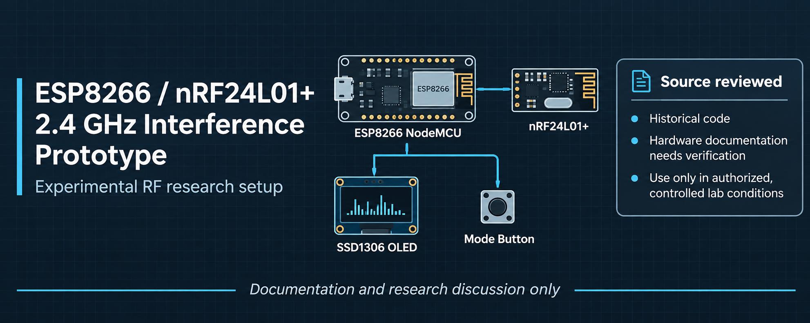

# ESP8266 / nRF24L01+ 2.4 GHz Interference Prototype



*Illustrative project artwork. It is not a verified wiring diagram, RF measurement, or evidence of interference performance.*

**Historical source for an experimental wireless-interference project.** This repository contains a single ESP8266-oriented source file using an nRF24L01+ 2.4 GHz transceiver, an SSD1306 OLED, and a push-button interface.

**Status:** Source review only · Build incomplete · Hardware and RF behaviour unverified

> **Safety:** This project concerns intentional RF interference. Do not operate it on live or shared wireless networks. RF transmission may disrupt nearby devices and services and may be restricted or unlawful. Use only properly authorised, shielded laboratory arrangements, and assess electrical and thermal hazards before powering hardware.

## What the repository contains

| Component | Role in the source |
| --- | --- |
| ESP8266-based NodeMCU | Host microcontroller |
| nRF24L01+ | External 2.4 GHz radio; the code requests a constant-carrier mode |
| SSD1306 OLED | Local mode/status display |
| Push button | Switches between menu states |
| Arduino libraries | RF24, SPI, Wire, ezButton, Adafruit GFX, Adafruit SSD1306 |

**Important distinction:** The ESP8266 has Wi-Fi but no native Bluetooth or BLE radio. The nRF24L01+ is not a BLE controller. The mode names in the source should not be interpreted as proof of BLE implementation, Bluetooth protocol interaction, or selective Wi-Fi interference.

## Project status and limitations

This is **not a verified, ready-to-build release**.

- The only source file currently published is `CODE-1`, not the `jammer.ino` named by the previous README.
- `CODE-1` includes `images.h`, which is not in the repository. Bitmap symbols referenced by the source are consequently unresolved as published.
- The previous wiring table assigned pins to both the OLED interface and the radio SPI interface. Connections and pin choices require a new schematic-level review.
- A code inspection does not establish real-world transmission characteristics, affected protocols, performance, reliability, or regulatory compliance.
- The source has not been modified or tested as part of the documentation refresh.

See [Technical review](docs/TECHNICAL_REVIEW.md) for findings and the evidence needed before treating the project as a reproducible research prototype.

## Suggested research direction

For controlled wireless-security education, a safer and more reproducible next iteration would focus on **passive spectrum observation, interference detection, coexistence measurements, and offline simulations**, with documented test conditions and quantitative results. These can be studied without deliberately disrupting third-party networks.

## Repository layout

```text
.
├── CODE-1                  # Original source; retained unchanged
├── README.md               # Project overview and current limitations
├── docs/
│   └── TECHNICAL_REVIEW.md # Code and hardware documentation audit
├── SECURITY.md             # Responsible-use and disclosure guidance
└── NOTICE.md               # Attribution and licensing status
```

## Maintainer

**Sai Tanveesh**

[GitHub](https://github.com/Saitanveesh) · [LinkedIn](https://www.linkedin.com/in/sai-tanveesh-028881215/)

## Licensing and attribution

No explicit open-source license is provided at present. Public access to the repository is **not** equivalent to permission to reuse, redistribute, or commercially exploit the work. Third-party code and image provenance must be reviewed before any license is selected or an original-authorship claim is made. See [NOTICE.md](NOTICE.md).

This repository is for documentation and research discussion only; it is not a product endorsement or an instruction to deploy an interference device.
